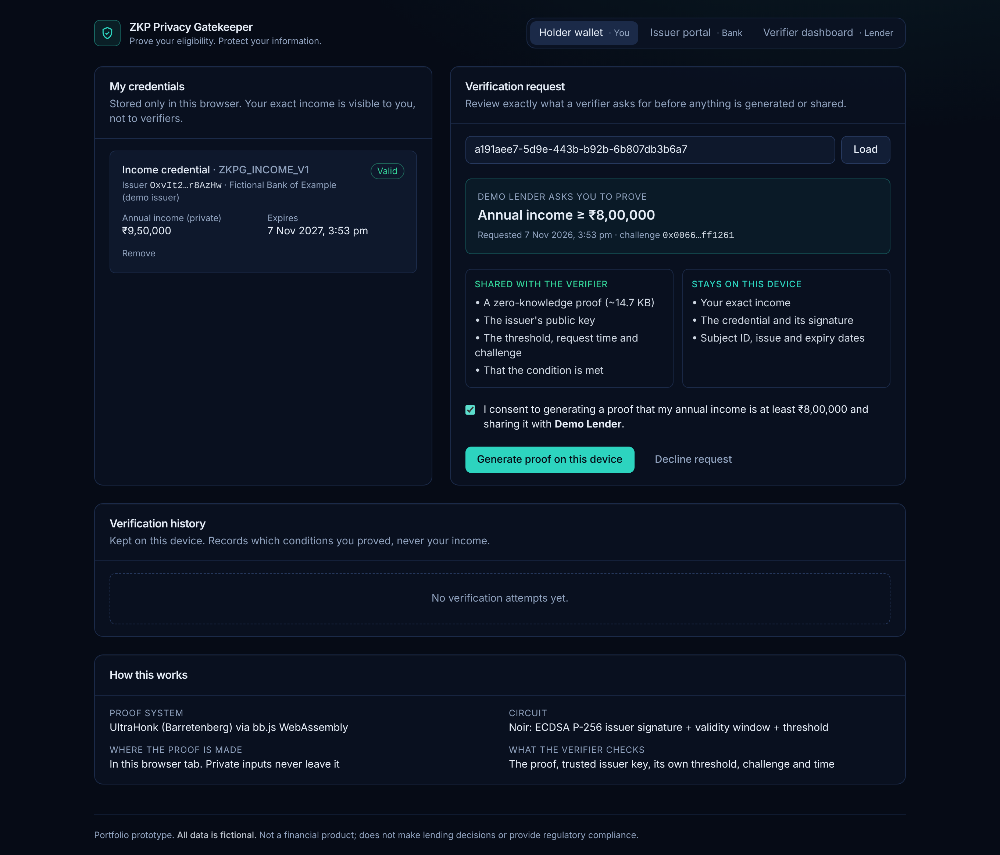
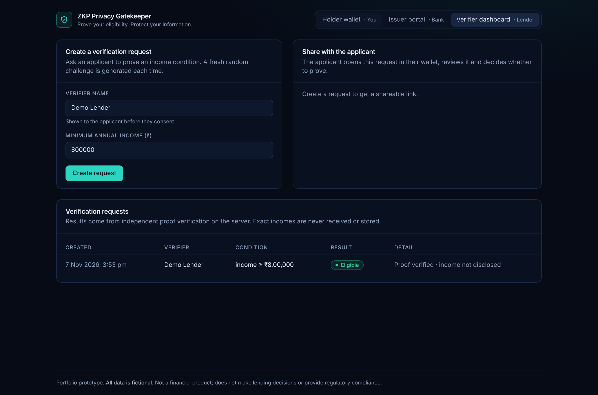

# ZKP Privacy Gatekeeper

**Prove Your Eligibility. Protect Your Information.**

A portfolio prototype for **privacy-preserving financial eligibility checks** using
genuine Zero-Knowledge Proofs (ZKPs), written in [Noir](https://noir-lang.org) and
proven with [Barretenberg](https://github.com/AztecProtocol/aztec-packages/tree/master/barretenberg).

> **Status: Milestone 6 — security and performance tested.** 179 automated tests plus a
> browser end-to-end suite; see the [test report](docs/test-report.md) and
> [benchmarks](docs/benchmarks/README.md).
>
> **Milestone 5 — hardened verification.** The full workflow runs in the
> browser (the holder **generates the proof locally**), and the verifier enforces
> single-use, expiring requests with persistent state, a privacy-conscious audit log,
> demo role tokens and rate limits. See the [security model](docs/security-model.md).
> See
> [`docs/development-log.md`](docs/development-log.md) for what has actually been built and tested.

## The idea

A lender wants to know: *"Is this applicant's annual income at least ₹8,00,000?"*

Today, applicants typically hand over salary slips or bank statements — far more data
than that yes/no decision needs. In this project:

1. A (simulated) **issuer** — e.g. a bank — signs a credential containing the applicant's income.
2. The **holder** generates a ZK proof *on their own device* showing that the
   issuer-signed income meets the lender's threshold.
3. The **verifier** (lender) checks the proof and learns **only** the result —
   not the exact income, not the credential.

The proof, its public inputs and necessary metadata are still transmitted. The goal is
not "zero data shared" but **not exposing the underlying private financial value**.

## Planned architecture

```text
Issuer ──signed credential──▶ Holder ──proof + public inputs──▶ Verifier ──▶ ELIGIBLE / NOT_ELIGIBLE / INVALID
```

| Role | Holds | Sends |
|---|---|---|
| Issuer | Fictional income claim, signing key | Signed credential (to holder only) |
| Holder | Credential, private witness | Proof + public inputs |
| Verifier | Issuer public key, policy, challenge | Result |

## Roadmap

| # | Milestone | Status |
|---|---|---|
| 0 | Environment & repository setup | ✅ Done |
| 1 | First real ZKP (income ≥ threshold) | ✅ Done (no issuer binding yet) |
| 2 | Issuer credential prototype (signing) | ✅ Done (ECDSA P-256, not yet in-circuit) |
| 3 | Credential-aware ZKP | ✅ Done |
| 4 | Holder / issuer / verifier UI | ✅ Done |
| 5 | Independent verification API (replay, expiry) | ✅ Done |
| 6 | Security & performance tests | ✅ Done |
| 7 | Portfolio release | ⏳ Planned |

## Try it (Milestone 1)

Requires Noir `nargo` 1.0.0 and Barretenberg `bb` 6.0.0. Install instructions are in
[`circuits/income-eligibility/README.md`](circuits/income-eligibility/README.md).

```bash
cd circuits/income-eligibility
nargo test           # circuit unit tests
./scripts/e2e.sh     # real proof generation + verification + attack checks
```

## Issue a credential (Milestone 2)

```bash
cd packages/credentials
npm install && npm test
npm run keygen                                   # demo issuer key (git-ignored)
npm run issue -- --subject 1001 --income 950000 --out demo.credential.json
```

Design docs: [test report](docs/test-report.md) · [benchmarks](docs/benchmarks/README.md) · [security model](docs/security-model.md) · [credential format](docs/credential-format.md) ·
[signature scheme evaluation](docs/signature-scheme-evaluation.md)

## Run the demo

Requires Node.js ≥ 22.12. No Noir toolchain is needed to run the app: it uses the
committed compiled circuit.

```bash
npm install
npm run setup       # creates .env with random demo role tokens (git-ignored)
npm run issuer      # terminal 1: issuer on :4001 (creates a demo key in apps/issuer-demo/keys/, git-ignored)
npm run verifier    # terminal 2: verifier on :4002 (trusts the issuer's published key)
npm run web         # terminal 3: http://localhost:5173
```

Then: **Issuer portal** → issue and deliver a credential → **Verifier dashboard** →
create a request → **Open in holder wallet** → review → consent → generate proof → submit.

| Holder: review and consent | Verifier: independent result |
|---|---|
|  |  |

```bash
npm test            # unit + API tests across all workspaces
npm run e2e         # real browser (Chromium): full flow with in-browser proving
npm run bench       # proof size and prove/verify timings (CLI, Node, Chromium)
```

## Prove a credential from the CLI (Milestone 3)

```bash
cd circuits/credential-eligibility && nargo test     # 11 circuit tests
cd ../../packages/credentials && npm run test:circuit # 18 real-proof tests
```

See [`docs/architecture.md`](docs/architecture.md) for what is proven, what stays
private and what the verifier must check.

## Planned stack

React + TypeScript + Vite · Tailwind CSS · Noir / Nargo · Barretenberg (UltraHonk) ·
bb.js · Node.js + Express · Vitest. Exact versions are pinned and recorded in the
development log once installed and verified.

## Scope and honesty

- **Fictional data only.** No real financial documents or personal data.
- Not connected to real banks; not a lending, KYC or compliance product.
- No claims of perfect privacy, absolute security or regulatory compliance.
  Known limitations will be documented as the project develops.

## Security

Issuer signing keys, `.env` files and private witness files (`Prover.toml`) are
excluded from version control by `.gitignore`.
